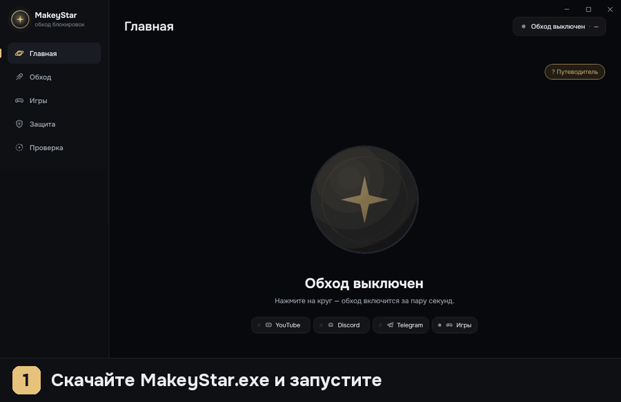

<div align="center">



<br><br>

<a href="https://github.com/MakeyST/MakeyStar-releases/releases/latest"></a>
<a href="https://github.com/MakeyST/MakeyStar-releases/releases"></a>
<a href="https://www.virustotal.com/gui/file/286dd25fb64adfcb2936feb252655cb91f277f6a1e612647440e460c45b75c00?nocache=1"></a>
<a href="https://t.me/+vHof0DrTv8thYTky"></a>


<br><br>

<a href="https://github.com/MakeyST/MakeyStar-releases/releases/latest/download/MakeyStar.exe"></a>
<a href="https://github.com/MakeyST/MakeyStar-releases/releases/download/v4.1.0/MakeyStar.dmg"></a>

**[Скачать для Windows](https://github.com/MakeyST/MakeyStar-releases/releases/latest/download/MakeyStar.exe)** · **[Скачать для Mac](https://github.com/MakeyST/MakeyStar-releases/releases/download/v4.1.0/MakeyStar.dmg)** ([как ставить](#mac)) · [Все выпуски](https://github.com/MakeyST/MakeyStar-releases/releases) · [Что нового](https://github.com/MakeyST/MakeyStar-releases/releases/latest) · [Telegram-канал](https://t.me/+vHof0DrTv8thYTky)

Бесплатная программа для **Windows и macOS**, которая возвращает нормальную работу **Discord, YouTube, сайтов и онлайн-игр**,
когда провайдер замедляет или режет соединение. Один файл — всё скачивает, настраивает и обновляет сам.
(Windows — всё: Discord, YouTube, сайты, игры, Щит, Telegram. Mac — Discord и YouTube, значком в строке меню.)

</div>

> [!IMPORTANT]
> **Настоящий MakeyStar есть только здесь: https://github.com/MakeyST/MakeyStar-releases**
>
> MakeyStar **бесплатный и не продаётся**. «Премиум-версии», ключи, подписки, «сборки с MakeyStar внутри»
> и копии на других сайтах — подделки. Автор их не проверял, и в них могут быть вирусы, майнеры и программы-шпионы.
> Подробнее — в разделе [«Права автора и защита от копий»](#rights).

<a id="new"></a>




- **Поиск по всей программе (`Ctrl+K`).** Набрали «рент» — сразу видите «Рентген сети» и попадаете на нужную вкладку; набрали «отч» — «Отчёт…». Регистр и «е/ё» не важны, лишние пробелы убираются, «рент А» тоже находит, неправильная раскладка («htyn») и опечатка в одну букву прощаются. Ищет разделы, вкладки, кнопки и переключатели и показывает путь. **Ваши собственные стратегии** находятся и включаются прямо из поиска. В поле нельзя вставить смайлики, теги и скрипты.
- **«Не открывается сайт?» — Врач сайта.** Вставьте адрес (или перетащите ссылку, или нажмите в трее — адрес возьмётся из буфера): MakeyStar по шагам найдёт, где рвётся (DNS, сервер, блокировка по имени), объяснит простыми словами и починит, если это лечится. Если у Discord, GitHub, Cloudflare или Twitch сейчас авария на их стороне — так и скажет: это не блокировка.
- **«Помог ли обход?»** Те же сервисы напрямую и через обход, рядом, с цифрами. Заодно видно, не тормозит ли сам обход остальной интернет.
- **Ярлыки на рабочем столе:** «Включить», «Выключить», «Переключить обход» — двойной щелчок, окно не открывается. Значки — знак MakeyStar в стиле «Космос».
- **Мини-окно поверх всех окон.** Круг со статусом и пингом: перетаскивайте, колесом меняйте размер, `Alt`+колесо — яркость, щелчок включает и выключает обход, правая кнопка — меню.
- **Свои горячие клавиши** для четырёх действий, а двойной щелчок по значку в трее открывает приложение.
- **Отчёт в PDF** в стиле MakeyStar (страницы A4): диагностика, доступность сервисов, утечки, MTU — чтобы отправить другу или мастеру.
- **Игры.** «Готов ли я к игре?» за пару секунд (DNS, обход, Wi-Fi или кабель, пинг, потери, лучший регион), «История пинга» по дням, «Игры с проблемами» и **«Игры из Steam»** — только онлайн-игры, с небольшими значками, быстрым поиском и прокруткой, даже если их 20–30. Бета: **тихие закачки** — на время игры замораживаются OneDrive, Dropbox, торренты и службы обновлений.
- **Рентген сети переделан** в стиле игрового радара: луч, вспышки у точек, плавные переезды. Появилась **проверка утечек DNS и IP** (в том числе IPv6 мимо VPN).
- **Щит:** отчёт за неделю (сколько заблокировано, какие домены и программы). **«Что мешает обходу»:** антивирусы с проверкой HTTPS, отказ Windows грузить драйвер. **«Почему не работало»:** журнал сбоев за 7 дней.
- **Сравнение двух стратегий** рядом, **проверка MTU**, **сторож DNS** (скажет, если кто-то сменил ваш DNS) и бета **«Аварийный DNS»** (на время сбоя DNS провайдера отвечает через защищённый DoH).
- **Переезд с другого обхода:** находит Zapret, GoodbyeDPI, ByeDPI, SpoofDPI, переносит ваши списки и останавливает их. **Портативный режим** (папка `data` рядом с exe), **экранный диктор** и клавиши `Ctrl+1…6`, `Ctrl+Q`, `F5`. **«Что нового»** после обновления и **проверка подлинности файла** в «Настройках».
- Ваши настройки, профили, стратегии и игры после обновления остаются как были. Полный список — в [описании выпуска](https://github.com/MakeyST/MakeyStar-releases/releases/latest).

> **Про Mac.** Сборка для macOS не менялась: качайте `MakeyStar.dmg` из выпуска 4.1.0 — ссылка в начале страницы
> и в разделе [MakeyStar для Mac](#mac). Правки 4.3.0 касаются Windows-части.

<a href="https://t.me/+vHof0DrTv8thYTky"></a>


<div align="center">

| | | |
|:---|:---|:---|
| **01** · [Быстрый старт](#start) | **02** · [Как это работает](#how) | **03** · [Возможности](#features) |
| **04** · [Как пользоваться](#usage) | **05** · [Обновления](#updates) | **06** · [Безопасность и проверка](#security) |
| **07** · [Что меняется в системе](#system) | **08** · [Вернуть всё как было](#revert) | **09** · [Конфиденциальность](#privacy) |
| **10** · [Сторонние компоненты](#components) | **11** · [Права автора](#rights) | **12** · [Частые вопросы](#faq) |
| **13** · [MakeyStar для Mac](#mac) | | |

</div>

<a id="start"></a>




<p align="center"></p>

**Нужно:** Windows 10 или 11 (64-бит), интернет и один раз подтвердить права администратора.

| Шаг | Что сделать |
|:---:|---|
| **1** | [Скачайте `MakeyStar.exe`](https://github.com/MakeyST/MakeyStar-releases/releases/latest/download/MakeyStar.exe) |
| **2** | Положите файл в постоянную папку, например `C:\MakeyStar` (не в «Загрузки», которые вы чистите) |
| **3** | Запустите и один раз подтвердите запрос Windows |
| **4** | Готово: MakeyStar сам скачает движок и стратегии, включит обход и покажет на главной **YouTube ✓ Discord ✓ Telegram ✓** |

> [!TIP]
> Не работает какой-то сервис (крестик ✗ у значка)? Нажмите **«Автоподбор»** прямо на главной —
> MakeyStar сам переберёт стратегии и оставит ту, что работает у вашего провайдера.

<a id="mac"></a>


## MakeyStar для Mac

Версия для macOS: обход **Discord и YouTube** на компьютерах Apple. Живёт звездой в строке меню —
как значок у часов в Windows-версии. Отдельного окна в Dock нет.

**Нужно:** macOS 13 (Ventura) или новее, Mac на Apple Silicon (M1–M4) или Intel, пароль администратора один раз.

| Шаг | Что сделать |
|:---:|---|
| **1** | [Скачайте `MakeyStar.dmg`](https://github.com/MakeyST/MakeyStar-releases/releases/download/v4.1.0/MakeyStar.dmg) |
| **2** | Откройте файл двойным щелчком и перетащите **MakeyStar** в папку «Программы» |
| **3** | **Первый запуск — правой кнопкой по MakeyStar → «Открыть» → ещё раз «Открыть»** (обычный двойной щелчок macOS не пустит, см. ниже) |
| **4** | Введите пароль Mac, когда попросят: он нужен один раз, чтобы поставить движок обхода |
| **5** | Нажмите большую кнопку **«Включить обход»** — дальше MakeyStar всё проверит и подберёт сам |

> [!IMPORTANT]
> **«MakeyStar повреждён и не может быть открыт» — это не вирус и не поломка.**
> Приложение бесплатное и не подписано платным сертификатом Apple ($99 в год), поэтому macOS помечает
> скачанный файл карантином. Лечится одним из двух способов:
> - правый клик по приложению → **«Открыть»**, затем в окне ещё раз **«Открыть»** (достаточно одного раза);
> - или в Терминале: `xattr -dr com.apple.quarantine /Applications/MakeyStar.app`

**Что умеет версия для Mac**

- Одна кнопка «Включить обход» / «Проверить и починить»: сама ставит движок, чинит его и подбирает стратегию,
  проверяя 17 адресов YouTube и Discord — тщательнее, чем встроенный автоподбор движка.
- Меню в строке состояния: включить и выключить обход, выбрать стратегию, списки сайтов, закрепить голос Discord,
  запуск при входе в систему, журнал.
- Створка «Для профи»: своя стратегия, разбор, диагностика, замер скорости, проверка конкретного сайта.
- **Работает вместе с VPN** и никогда его не выключает: пока VPN держит весь трафик, обход ждёт и не мешает.

**Чего в версии для Mac нет**

Игр и ускорения игр, рентгена сети, скорости по программам, раздачи обхода на приставку, ускорения Telegram
и безопасного DNS. Всё это держится на внутренних механизмах Windows (WinDivert, ETW, WMI, брандмауэр Windows),
которых в macOS нет. Для Discord и YouTube версия для Mac самодостаточна.

**Обновление.** Скачайте новый `MakeyStar.dmg` из свежего выпуска и замените приложение в «Программах» —
настройки и стратегии останутся на месте.

<a id="how"></a>




MakeyStar — это удобная оболочка и собственные «умные» алгоритмы вокруг проверенного движка
**[zapret](https://github.com/bol-van/zapret)** от **[bol-van](https://github.com/bol-van)** и стратегий
**[zapret-discord-youtube](https://github.com/Flowseal/zapret-discord-youtube)** от **[Flowseal](https://github.com/Flowseal)**.
Движок меняет служебные части сетевых пакетов так, что оборудование провайдера (DPI) их не узнаёт и не замедляет.

**Это не VPN:** трафик не идёт через чужие серверы, скорость и пинг остаются вашими.

MakeyStar бесплатный, потому что стоит на открытых проектах [bol-van](https://github.com/bol-van) и [Flowseal](https://github.com/Flowseal), — и останется бесплатным.

<a id="features"></a>


<table>
<tr>
<td width="50%" valign="top">

<h3>&nbsp; Обход блокировок</h3>

- Discord (сообщения, голос, картинки), YouTube, сайты.
- Движок [zapret](https://github.com/bol-van/zapret) + все стратегии [Flowseal](https://github.com/Flowseal/zapret-discord-youtube), обновляются сами.
- **Один exe**, ничего ставить не нужно.
- **Автозапуск в трее** без постоянных запросов UAC.
- **Работает вместе с VPN** — не ломает туннель, а если после выключения VPN в Wi‑Fi остался его DNS, MakeyStar это заметит и предложит «Исправить».

</td>
<td width="50%" valign="top">

<h3>&nbsp; Умная подборка</h3>

- **Проверка при запуске**: не открылся Discord или YouTube — пробует другие конфиги.
- **Самопочинка** раз в 4 минуты. Выключили — ничего не меняет без вас.
- **Умная сборка** лучшей стратегии из всех конфигов Flowseal.
- **Эволюция стратегий** и **песочница**: проверка за ~10 с, не прерывая обход.
- **Врач сайта**: адрес не открывается — найдёт, где рвётся, и починит; **сравнение двух стратегий**.
- **Автоподбор** и подбор под нужные сервисы. «Стоп» ничего не меняет — всё возвращается как было.

</td>
</tr>
<tr>
<td valign="top">

<h3>&nbsp; Игры</h3>

- **Сканирование игры**, как в платных «ускорителях»: TCP и UDP, только серверы игры.
- Следит за **всей папкой игры** — лаунчер, клиент, античит, голосовой чат.
- **Дообучение** во время игры: новые серверы дописываются сами, мусор не попадает.
- Обход включается только для **запущенной** игры.
- **Бережёт вход в игру**: пока игра открыта, обход не перезапускается, а серверы входа (например, Activision в Call of Duty) идут напрямую.
- **Перед игрой**: «готов ли я», история пинга, игры с проблемами, **игры из Steam** (только онлайн).
- **Ближний сервер на время игры**: пинг до серверов матчей и закрепление близкого региона.

</td>
<td valign="top">

<h3>&nbsp; Мои профили</h3>

- Своя связка: **стратегия + игровой фильтр + IPSet** одной кнопкой.
- **«Как в чистом Flowseal»** — аргументы один в один как у батника.
- **Привязка к игре** (exe или папка): профиль сам включается при запуске игры и возвращает всё после выхода.
- Ваш ручной выбор во время игры MakeyStar не перебивает.
- Переименовали стратегию — профили переименуются вместе с ней.

</td>
</tr>
<tr>
<td valign="top">

<h3>&nbsp; Рентген сети и скорость</h3>

- Ваш IP (скрыт), провайдер и город — и настоящий провайдер при VPN.
- Какие программы в интернете, куда подключаются, через обход/VPN/напрямую, **скорость каждой**.
- **Проверка утечек DNS и IP** и **«Помог ли обход?»** — с цифрами.
- **Замер скорости** как на yandex.ru/internet и **пинг до игровых дата-центров** Европы, Азии и США.

</td>
<td valign="top">

<h3>&nbsp; Щит, DNS и прочее</h3>

- **Щит от рекламы и слежки**: мягкий (~6 500) или строгий (~70 000 доменов) + **свои правила AdGuard** и подписки.
- **Безопасный DNS** (Cloudflare, Google, Quad9, AdGuard) одним переключателем.
- **Защита сайтов** во всех браузерах через hosts и расширение **MakeyStar Guard** — ставится в один клик.
- **Telegram**: TG WS Proxy от [Flowseal](https://github.com/Flowseal/tg-ws-proxy) в один клик.
- **Темы**: «Классика», «Неон», «Полночь» и **своя** — меняются сразу, без перезапуска.
- **Ярлыки и мини-окно**, **поиск `Ctrl+K`**, **свои горячие клавиши**, **отчёт в PDF**, **портативный режим**.

</td>
</tr>
</table>

<a id="usage"></a>


Разделы слева собраны в группы **«Обход»**, **«Игры»**, **«Защита»** и **«Ещё»** — нажмите на название группы, чтобы раскрыть её.

| Раздел | Для чего | Главная кнопка |
|---|---|---|
| **Главная** | включить/выключить обход, значки YouTube/Discord/Telegram; ползунок «Дополнительно» — стратегия, игровой фильтр, IPSet, профили | знак-звезда в центре |
| **Умная подборка** | самопочинка, умная сборка, эволюция стратегий | переключатель «Часы — обход чинится сам» |
| **Игры** | статус игры, ближний сервер; «Для опытных» — сканер, игровой фильтр, профили | ничего: запустите игру, остальное MakeyStar сделает сам |
| **Стратегии** | все конфиги Flowseal и свои, редактор аргументов, ваши профили | «Включить эту стратегию» / «Включить профиль» |
| **Проверка и подбор** | автоподбор под вашего провайдера | «Автоподбор» |
| **Рентген сети** | кто в сети, куда подключается, скорость программ | открывается сразу |
| **Замер скорости** | скорость, пинг до игровых регионов, лучший регион загрузки Steam | «Проверить регионы Steam» → «Применить» |
| **Для приставки** (Beta) | обход для PlayStation, Switch и телефона, Wi‑Fi с компьютера | «Включить раздачу» |
| **Щит и DNS** | реклама, слежка, свои правила, безопасный DNS | переключатели |
| **Сайты и списки** | свои сайты для обхода и исключения | «Сохранить» |
| **Telegram** | TG WS Proxy от Flowseal | переключатель Telegram |
| **Диагностика** | конфликты, состояние обхода, кэш Discord | «Запустить диагностику» |
| **Настройки** | автозапуск, обновления, темы, расширение браузера, «Вернуть всё как было» | «Проверить обновления» |

<details>
<summary><b>Как настроить игру — пошагово</b></summary>
<br>

Обычно ничего настраивать не нужно: просто запускайте игру. Сканер нужен, если хотите обход именно для серверов этой игры.

1. Запустите игру и зайдите в лобби.
2. **Игры → «Для опытных» → «Сканировать игру»** → выберите игру в списке.
3. Пока идёт сканирование (60 с), зайдите в бой — MakeyStar запомнит серверы и порты.
4. Дальше ничего делать не нужно: при запуске игры обход её серверов включается сам, новые серверы дописываются во время игры.
5. По желанию: **«Ближний сервер на время игры»** — замер пинга до серверов матчей и закрепление близкого региона (после первого сыгранного матча).

</details>

<details>
<summary><b>Как сделать свой профиль под игру (пример: Wardogs)</b></summary>
<br>

1. **Главная → включите «Дополнительно» → «Мои профили» → «Новый профиль»**, название «Wardogs».
2. Стратегия **general (EXP)**, игровой фильтр **TCP+UDP**, IPSet **«По списку»**, переключатель **«Как в чистом Flowseal»**.
3. **«Привязать к игре»** → **«Файл .exe»** или **«Папка»** игры, включите **«Включать автоматически при запуске игры и выключать при выходе»**.
4. **«Сохранить»**. Теперь при запуске игры профиль включится сам, а после выхода вернётся прежний режим.
5. Включить профиль вручную можно в **«Стратегиях»** (блок «Мои профили») или в трее: **значок у часов → «Мои профили»**.

</details>

<details>
<summary><b>Как добавить расширение MakeyStar Guard в браузер</b></summary>
<br>

1. **Настройки → Браузер и горячие клавиши** → нажмите кнопку своего браузера (Яндекс, Edge, Chrome, Opera…).
2. MakeyStar сам откроет в нём страницу расширений. Справа вверху включите **«Режим разработчика»**.
3. **«Загрузить распакованное расширение»** → вставьте путь к папке (он уже скопирован, `Ctrl+V`) → **«Выбор папки»**.
4. Готово — в MakeyStar загорится «на связи». Расширение необязательно: защита сайтов работает и без него.

</details>

<a id="updates"></a>


Ничего делать не нужно: MakeyStar сам проверяет новые версии (через 20 секунд после запуска и затем раз в час).

1. Показывает окно «что нового» с кнопками **«Обновить сейчас»** и **«Позже»**.
2. Скачивает новую версию **только с этой страницы**, проверяет контрольную сумму SHA-256 и подпись автора.
3. Заменяет себя и перезапускается — настройки сохраняются.

**Вручную:** **Настройки → Обновления MakeyStar → «Проверить обновления»**. Во время игры программа не отвлекает.
Новости о выпусках — в нашем [Telegram-канале](https://t.me/+vHof0DrTv8thYTky).

> Версии **2.3 и старше** обновляться не умеют — их нужно один раз заменить на свежую вручную.

<a id="security"></a>


<table>
<tr>
<td width="33%" valign="top" align="center">

<br>

**VirusTotal**<br>
Файл проверен десятками антивирусов.<br>
**[Открыть отчёт VirusTotal](https://www.virustotal.com/gui/file/286dd25fb64adfcb2936feb252655cb91f277f6a1e612647440e460c45b75c00?nocache=1)**<br>
<sub>отчёт для версии 2.9.3</sub>

</td>
<td width="33%" valign="top" align="center">

<br>

**Цифровая подпись**<br>
Правый клик по `MakeyStar.exe` → «Свойства» → «Цифровые подписи».<br>
Издатель: **Makeenkov Igor**

</td>
<td width="33%" valign="top" align="center">

<br>

**SHA-256**<br>
К каждому выпуску приложен `MakeyStar.exe.sha256` — сумма должна совпасть полностью.

</td>
</tr>
</table>

Проверить контрольную сумму вашего файла:

```powershell
Get-FileHash .\MakeyStar.exe -Algorithm SHA256
```

Любую версию можно проверить на VirusTotal самому: откройте `https://www.virustotal.com/gui/file/<SHA-256 из файла .sha256>`
или загрузите файл на [virustotal.com](https://www.virustotal.com/).

> [!NOTE]
> **Почему антивирус или SmartScreen может насторожиться.** Драйвер [WinDivert](https://github.com/basil00/WinDivert)
> перехватывает сетевые пакеты — так устроен **любой** обход DPI, и некоторые антивирусы помечают это эвристикой.
> Подпись автора сделана своим сертификатом, а не купленным у центра сертификации, поэтому SmartScreen её не знает.
> Если файл скачан **отсюда**, подпись и SHA-256 совпадают — всё в порядке.

<a id="system"></a>


Всё перечисленное нужно только для работы программы и отменяется кнопкой **«Вернуть всё как было»**.

| Что | Зачем |
|---|---|
| Драйвер **WinDivert** (загружается движком winws) | перехват и изменение сетевых пакетов — основа обхода DPI |
| Процесс **winws.exe** | движок обхода [zapret](https://github.com/bol-van/zapret) |
| Файл **hosts** — только свой блок между метками, чужие записи не трогаются | починка отдельных сайтов, щит от рекламы, ваши правила |
| Задачи планировщика **MakeyStar** и **MakeyStar-Run** | автозапуск в трее и запуск с правами администратора без запроса UAC |
| Сетевая настройка TCP `timestamps=enabled` | требуется стратегиям [Flowseal](https://github.com/Flowseal/zapret-discord-youtube) |
| Журнал Windows **DNS-Client/Operational** (включается) | защита сайтов: видно, какие сайты не открылись |
| Службы других обходов (`zapret`, `GoodbyeDPI`, `winws1/2` и т. п.) останавливаются | два обхода одновременно ломают сеть |
| DNS адаптеров и DoH — **только если вы включили «Безопасный DNS»** | шифрованный DNS; прежние значения сохраняются и возвращаются |
| Правило брандмауэра для exe игры — **только если вы закрепили регион** | игра подключается только к выбранному региону; снимается при удалении игры |
| Сертификат автора в «Доверенные» — **только если вы согласились** | чтобы Windows доверяла подписи MakeyStar на этом ПК |
| Задачи планировщика **MakeyStar-Cmd-on / off / toggle** — **только если вы создали ярлыки** на рабочем столе | чтобы ярлык включал и выключал обход без запроса UAC |
| Процессы OneDrive, Dropbox, торрентов и службы **wuauserv, DoSvc** на время игры — **только если вы включили «Тихие закачки»** | меньше фоновой нагрузки на канал; после игры всё возвращается |
| DNS сетевых карт на `127.0.0.1` — **только если вы включили «Аварийный DNS»** и DNS провайдера не отвечает | пока он не оживёт; прежние адреса записаны и вернутся |
| Папка **%APPDATA%\MakeyStar** (или папка `data` рядом с exe, если вы её создали) | настройки, стратегии, списки, бэкапы hosts, журналы, загрузки |

MakeyStar не ставит других программ, кроме компонентов обхода и (по вашему выбору) TG WS Proxy. Расширение для браузера
добавляете только вы сами — MakeyStar лишь открывает нужную страницу.

<a id="revert"></a>


**Настройки → «Вернуть всё как было»**: останавливает обход и Telegram-прокси, выгружает WinDivert,
возвращает исходный hosts и DNS, снимает закрепление регионов, выключает щит и журнал DNS, убирает автозапуск.
После этого `MakeyStar.exe` и папку `%APPDATA%\MakeyStar` можно просто удалить.

<a id="privacy"></a>


MakeyStar **не собирает и не отправляет автору никаких данных**: нет телеметрии, аналитики и учётных записей.
Сетевые обращения — только для работы функций:

| Куда | Зачем |
|---|---|
| `github.com`, `api.github.com`, `raw.githubusercontent.com` | обновления MakeyStar, загрузка [zapret](https://github.com/bol-van/zapret), стратегий [Flowseal](https://github.com/Flowseal/zapret-discord-youtube), TG WS Proxy, списков |
| `discord.com`, `youtube.com`, `googlevideo.com` и сайты из ваших списков | проверка, открываются ли сервисы |
| `yandex.ru/internet` и узлы `*.cdn.yandex.net` | замер скорости |
| `ipwho.is`, `ip-api.com` | «Рентген сети»: ваш IP, провайдер, город; владельцы адресов |
| `cloudflare-dns.com`, `dns.google`, `dns.quad9.net`, `dns.adguard-dns.com` | безопасный DNS и проверка настоящих адресов сайтов |
| `adaway.org`, `raw.githubusercontent.com/StevenBlack` и ваши подписки | списки рекламы для щита и правил |
| `discordstatus.com`, `githubstatus.com`, `cloudflarestatus.com`, `status.twitch.tv` | «это не блокировка, у сервиса авария» (публичные страницы статуса) |
| `store.steampowered.com` | узнать, какие игры Steam онлайн (результат запоминается на компьютере) |
| `speed.cloudflare.com` | сравнение скорости с обходом и без |
| `1.1.1.1`, `8.8.8.8`, `9.9.9.9`, `whoami.akamai.net`, `api6.ipify.org` | проверка утечек DNS и IP, MTU, «Аварийный DNS» (DoH) |
| дата-центры AWS, Hetzner, OVH | пинг до игровых регионов (только установка соединения) |
| `127.0.0.1` (только этот компьютер) | связь с расширением MakeyStar Guard по секретному ключу |

<a id="components"></a>


**MakeyStar:** C# · .NET 10 · WPF · однофайловый exe (`win-x64`, self-contained), подписан Authenticode с меткой времени DigiCert.

MakeyStar — это **оболочка и собственные алгоритмы** вокруг открытых проектов. Эти проекты **не принадлежат** автору MakeyStar,
**не встроены в exe** и скачиваются программой **из их официальных источников** по их лицензиям:

| Компонент | Автор | Лицензия |
|---|---|---|
| [zapret](https://github.com/bol-van/zapret) — движок winws | [bol-van](https://github.com/bol-van) | MIT |
| [zapret-discord-youtube](https://github.com/Flowseal/zapret-discord-youtube) — стратегии и списки | [Flowseal](https://github.com/Flowseal), [bol-van](https://github.com/bol-van) | MIT |
| [WinDivert](https://github.com/basil00/WinDivert) — драйвер перехвата пакетов | [basil00](https://github.com/basil00) | LGPL v3 / GPL v2 |
| [TG WS Proxy](https://github.com/Flowseal/tg-ws-proxy) | [Flowseal](https://github.com/Flowseal) | MIT |
| [StevenBlack/hosts](https://github.com/StevenBlack/hosts) — строгий список щита | Steven Black и участники | MIT |
| [AdAway hosts](https://adaway.org/) — мягкий список щита | проект AdAway | CC BY 3.0 |
| System.Management, TraceEvent | Microsoft | MIT |

**Спасибо [bol-van](https://github.com/bol-van) и [Flowseal](https://github.com/Flowseal)** — без их работы MakeyStar не было бы.

<a id="rights"></a>


**© 2026 Makeenkov Igor (Макеенков Игорь). Все права защищены.**

MakeyStar придуман и создан автором с нуля. Это **авторская программа** и интеллектуальная собственность автора.

### Что принадлежит автору
- исходный и объектный код MakeyStar, файл `MakeyStar.exe`;
- собственные алгоритмы и их реализация: умная сборка, эволюция стратегий, песочница, самопочинка, проверка при запуске,
  сканирование и дообучение игр, игровой режим, свои профили с привязкой к играм, «Рентген сети», замер скорости,
  защита сайтов, щит и безопасный DNS, расширение MakeyStar Guard, самообновление;
- интерфейс, дизайн, темы, анимации, звуки, тексты программы и этой страницы;
- название **MakeyStar** и логотип.

Компоненты из раздела [«Сторонние компоненты»](#components) — собственность их авторов и используются по их лицензиям.

<h3>&nbsp; Можно</h3>

- бесплатно скачивать MakeyStar **с этой страницы** и пользоваться им дома и на работе;
- делиться **ссылкой на эту страницу** или на [Telegram-канал](https://t.me/+vHof0DrTv8thYTky), писать обзоры и снимать видео о программе.

<h3>&nbsp; Запрещено без письменного разрешения автора</h3>

- **продавать** MakeyStar или брать плату за скачивание, установку, «ключи», «премиум», подписку или доступ;
- выкладывать `MakeyStar.exe` где-либо, кроме этой страницы, — в том числе в «сборках», «паках», установщиках, образах Windows;
- изменять, декомпилировать, перепаковывать, удалять подпись или имя автора;
- выдавать MakeyStar или его части за свою разработку, использовать название и логотип MakeyStar для других продуктов.

Полный текст условий — в [LICENSE.md](LICENSE.md).

<h3>&nbsp; Копии опасны</h3>

Копии MakeyStar с других сайтов, «перепакованные» и «улучшенные» версии, а также программы, которые выдают себя за MakeyStar,
**автор не создавал и не проверял**. Именно в таких файлах чаще всего прячут вирусы, майнеры и программы для кражи паролей.
Оригинал всегда: подписан **Makeenkov Igor**, совпадает по SHA-256 с файлом на этой странице и скачивается только отсюда.

<h3>&nbsp; Защита в России и других странах</h3>

Авторское право на программу возникает с момента её создания и не требует регистрации. Оно действует в России
(ст. 1259, 1261, 1270 ГК РФ) и во всех странах — участницах **Бернской конвенции** (более 180 стран, включая страны СНГ, ЕС и США),
а также по соглашению ТРИПС ВТО.

За продажу или распространение чужой программы без разрешения предусмотрены:
- **Россия** — компенсация от 10 000 до 5 000 000 ₽ или двукратная стоимость экземпляров (ст. 1252, 1301 ГК РФ),
  штраф и конфискация (ст. 7.12 КоАП РФ), уголовная ответственность при крупном размере (ст. 146 УК РФ);
- **другие страны** — ответственность по их законам об авторском праве (например, ст. 201 УК Беларуси, ст. 198 УК Казахстана,
  законы ЕС и США).

Копии MakeyStar на GitHub удаляются по [процедуре DMCA](https://docs.github.com/ru/site-policy/content-removal-policies/dmca-takedown-policy),
на других площадках — по жалобе правообладателя.

**Встретили продажу MakeyStar или копию на другом сайте?** Сообщите через [Issues](https://github.com/MakeyST/MakeyStar-releases/issues) —
ссылку на страницу и, если есть, скриншот.

### Отказ от гарантий
MakeyStar предоставляется «как есть», бесплатно и без каких-либо гарантий. Автор не отвечает за возможный ущерб
от использования программы. Пользователь сам отвечает за соблюдение законов своей страны и правил своего провайдера.

<a id="faq"></a>


<details>
<summary><b>А на Mac работает?</b></summary>
<br>

Да. Сборка для Mac лежит в выпуске 4.1.0 (`MakeyStar.dmg`) и с тех пор не менялась — правки 4.2.0 касаются Windows-части. Качайте её по ссылке выше; это та же актуальная mac-версия 1.1.0. Начиная с 4.1.0 в выпуске есть `MakeyStar.dmg` — обход **Discord и YouTube** для macOS 13 и новее.
Установка и важное про первый запуск — в разделе <a href="#mac">MakeyStar для Mac</a>. Игры, рентген сети
и раздача на приставку есть только в версии для Windows: в macOS нет механизмов, на которых они работают.

</details>

<details>
<summary><b>Это VPN?</b></summary>
<br>
Нет. MakeyStar не гонит трафик через чужие серверы — он меняет служебные части пакетов, чтобы оборудование провайдера (DPI)
не мешало соединению. Скорость и пинг остаются вашими.
</details>

<details>
<summary><b>После VPN ничего не открывается, даже обычные сайты</b></summary>
<br>

Скорее всего, VPN (Incy, Hiddify, Happ, Clash и др.) оставил в настройках Wi‑Fi или кабеля свой DNS — например, `198.18.0.2`. Пока VPN работает, это нормально, а после выключения компьютер не может узнать адреса сайтов. MakeyStar покажет это на главной: **«Не работает DNS»** → **«Исправить»** — и вернёт DNS от роутера. Вручную: Параметры Windows → Сеть → свойства подключения → «Назначение DNS-сервера» → «Автоматически (DHCP)».

</details>

<details>
<summary><b>Чем MakeyStar отличается от батников Flowseal?</b></summary>
<br>
Стратегии те же — от <a href="https://github.com/Flowseal/zapret-discord-youtube">Flowseal</a> на движке
<a href="https://github.com/bol-van/zapret">zapret</a>. MakeyStar добавляет то, чего нет в батниках: сам подбирает и чинит стратегию,
настраивает игры, переключает профили, обновляется сам и всё это — в понятном окне. Нужно поведение один в один как у батника —
включите в своём профиле «Как в чистом Flowseal».
</details>

<details>
<summary><b>Игра всё равно не работает</b></summary>
<br>
Отсканируйте игру во время боя (<b>Игры → «Сканировать игру»</b>) и попробуйте профиль с игровым фильтром.
Если провайдер блокирует сами IP-адреса серверов игры (а не по DPI), обход DPI не поможет — нужен туннель (VPN или игровой ускоритель).
</details>

<details>
<summary><b>Кнопка браузера в настройках открыла страницу, а что дальше?</b></summary>
<br>
Справа вверху страницы расширений включите «Режим разработчика», нажмите «Загрузить распакованное расширение» и вставьте путь
к папке (MakeyStar уже скопировал его — <code>Ctrl+V</code>). Если браузер не открылся, нажмите на адрес в окне подсказки:
он скопируется, останется вставить его в адресную строку.
</details>

<details>
<summary><b>Антивирус ругается — что делать?</b></summary>
<br>
Проверьте, что файл скачан с этой страницы, подпись — <b>Makeenkov Igor</b>, а SHA-256 совпадает с файлом <code>.sha256</code> выпуска.
Подробно — в разделе <a href="#security">«Безопасность и проверка»</a>.
</details>

<details>
<summary><b>Где настройки и журнал?</b></summary>
<br>
<code>%APPDATA%\MakeyStar</code> (журналы — в папке <code>logs</code>).
</details>

<details>
<summary><b>Где узнавать о новых версиях?</b></summary>
<br>
MakeyStar сам предложит обновиться. А новости, советы и ответы на вопросы — в нашем
<a href="https://t.me/+vHof0DrTv8thYTky">Telegram-канале</a> (кнопка «Наш Telegram-канал» есть и в меню программы).
</details>

<details>
<summary><b>Можно выложить MakeyStar на свой сайт или канал?</b></summary>
<br>
Выкладывайте <b>ссылку на эту страницу</b> — так у людей будет настоящая версия с автообновлением. Сам файл выкладывать нельзя.
</details>

<br>

<div align="center">


Автор: **Makeenkov Igor** · [github.com/MakeyST](https://github.com/MakeyST) · [Telegram-канал](https://t.me/+vHof0DrTv8thYTky)<br>
<sub>Работает благодаря <a href="https://github.com/bol-van/zapret">zapret</a> от <a href="https://github.com/bol-van">bol-van</a> и стратегиям <a href="https://github.com/Flowseal/zapret-discord-youtube">Flowseal</a>.</sub>

</div>
